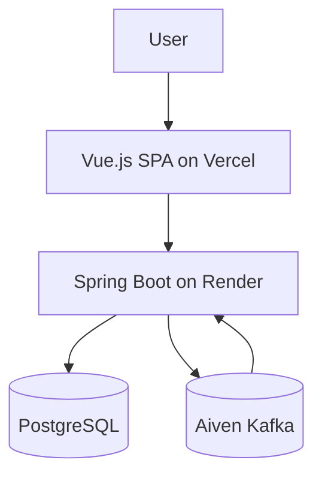

# Architecture Documentation: CargoFlow

**Date:** 2025-10-04
**Author:** Project Team
**Version:** 1.0

## 1. Overview
CargoFlow is a three-tier supply chain cargo management system with an asynchronous event layer for real-time updates.

### Core Components
- Frontend: Vue.js SPA hosted on Vercel
- Backend: Spring Boot service hosted on Render
- Database: PostgreSQL
- Event Bus: Aiven Kafka

## 2. System Design

The application follows a layered backend architecture:
- Controller layer handles HTTP requests and validation
- Service layer contains business logic
- Repository layer manages data access

## 3. Data Flow

### Synchronous Flow
1. The user performs an action in the frontend.
2. The frontend sends a request to the backend.
3. The backend validates the request and writes to PostgreSQL.
4. The backend returns a response to the frontend.

### Asynchronous Flow
1. The backend publishes an event to Kafka.
2. Consumers process the event and update downstream views or notifications.

## 4. Deployment Topology

CargoFlow is deployed with the following stack:
- Frontend: Vercel
- Backend: Render
- Database: PostgreSQL
- Kafka: Aiven

## 5. Component Responsibilities

| Component | Responsibility |
| --- | --- |
| Frontend | Render UI, handle navigation, and call backend APIs |
| Backend | Expose REST APIs, enforce business rules, and publish events |
| PostgreSQL | Persist cargo, shipment, vendor, route, and delivery data |
| Aiven Kafka | Carry asynchronous domain events |

## 6. External Integrations
- OAuth login for user authentication
- Email notifications for operational events
- Real-time updates through WebSockets and Kafka-driven event handlers
