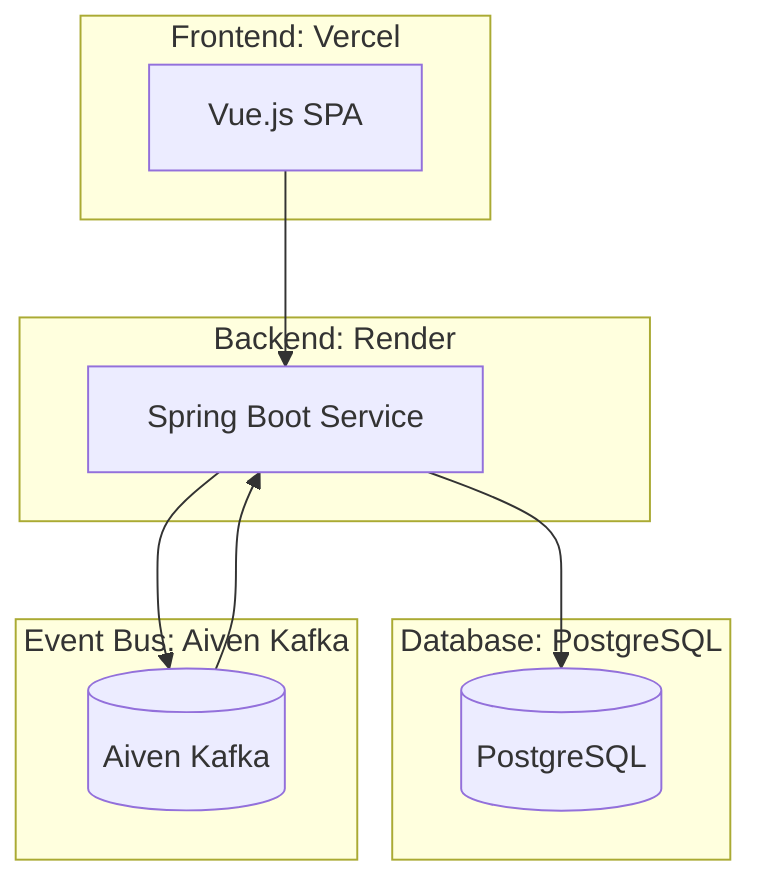

# CargoFlow

CargoFlow is a full-stack cargo management system for tracking shipments, managing vendors, routing deliveries, and handling logistics workflows.

## Tech Stack
- Frontend: Vue 3
- Backend: Spring Boot
- Database: PostgreSQL
- Event Bus: Aiven Kafka
- Frontend Hosting: Vercel
- Backend Hosting: Render

## Project Structure
```text
.
├── client/  # Vue frontend
├── docs/    # Documentation
└── server/  # Spring Boot backend
```

## System Overview
The application uses a layered backend, a Vue single-page app, PostgreSQL for persistence, and Kafka for event-driven updates.



For implementation details, see [ARCHITECTURE.md](./ARCHITECTURE.md).

## Getting Started

### Prerequisites
- Java 17+
- Maven
- Node.js and Bun
- PostgreSQL

### Backend
```bash
cd server
mvn clean install
mvn spring-boot:run
```

### Frontend
```bash
cd client
bun install
bun run dev
```

## Documentation
- [ARCHITECTURE.md](./ARCHITECTURE.md)
- [docs/](./docs)

