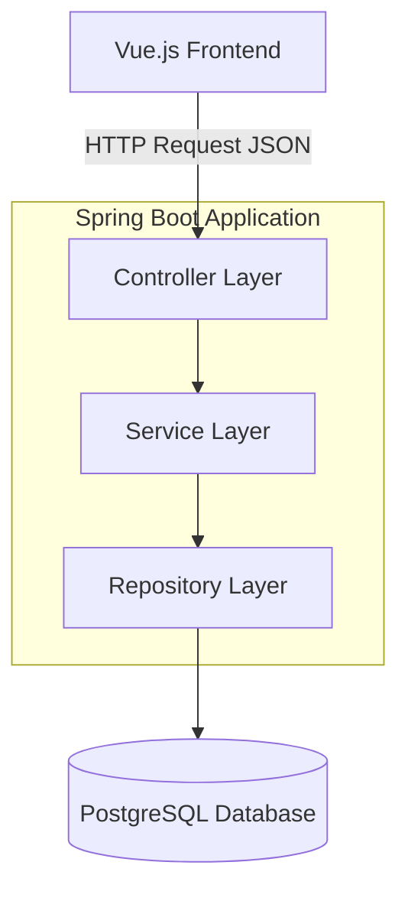

# Backend High-Level Design (HLD)

This document provides a detailed High-Level Design (HLD) for the **Java Spring Boot backend service**. It outlines the architectural layers, data flow, and the preliminary REST API endpoint structure for the **Supply Chain Cargo Management System**.

---

## 2. Layered Architecture

The backend follows a **3-layer architecture** to enforce separation of concerns, which improves maintainability, testability, and scalability. Business logic is isolated from both the web interface and database access.

---

### 2.1 Controller Layer

**Responsibilities:**

* Acts as the entry point for API requests.
* Handles HTTP methods (`GET`, `POST`, `PUT`, `DELETE`).
* Performs request validation and parsing.
* Delegates execution to the Service Layer.
* Sends back structured JSON responses.

**Technology:**

* Spring Web MVC (`@RestController`, `@RequestMapping`, `@GetMapping`, `@PostMapping`, etc.).

---

### 2.2 Service Layer

**Responsibilities:**

* Implements **core business logic**.
* Orchestrates repository calls.
* Performs complex domain operations (e.g., vendor assignment, ETA calculation).
* Operates independently of the web layer.

**Technology:**

* Spring Framework (`@Service`, `@Transactional`).

---

### 2.3 Repository Layer

**Responsibilities:**

* Manages **data persistence and retrieval**.
* Abstracts away raw SQL through JPA.
* Provides CRUD (Create, Read, Update, Delete) functionality.

**Technology:**

* Spring Data JPA (`JpaRepository`, custom queries if needed).

---

## 3. Preliminary REST API Endpoints

| Method | URI Path                            | Description                        |
| ------ | ----------------------------------- | ---------------------------------- |
| GET    | `/api/shipments`                    | Retrieves a list of all shipments. |
| GET    | `/api/shipments/{id}`               | Retrieves details of a shipment.   |
| POST   | `/api/shipments`                    | Creates a new shipment.            |
| PUT    | `/api/shipments/{id}/assign-vendor` | Assigns a vendor to a shipment.    |
| GET    | `/api/cargo`                        | Retrieves all cargo items.         |
| POST   | `/api/cargo`                        | Creates a new cargo item.          |
| GET    | `/api/vendors`                      | Retrieves a list of all vendors.   |

---
